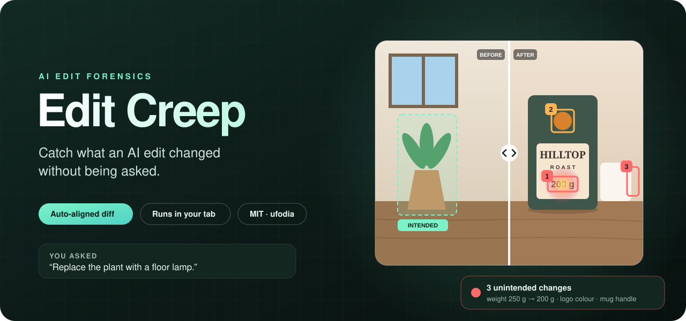
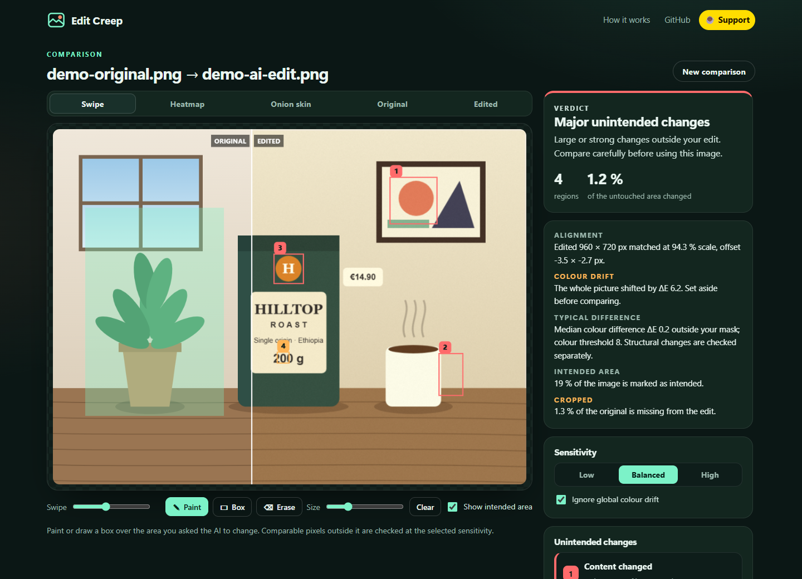
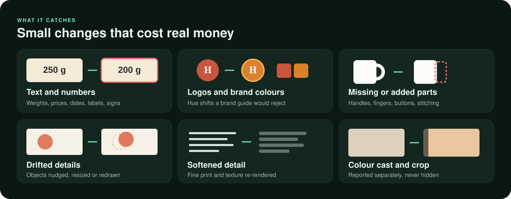
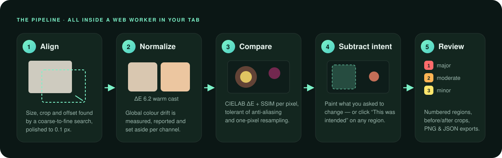
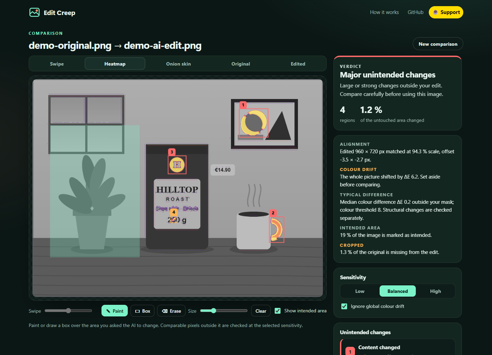
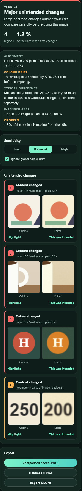
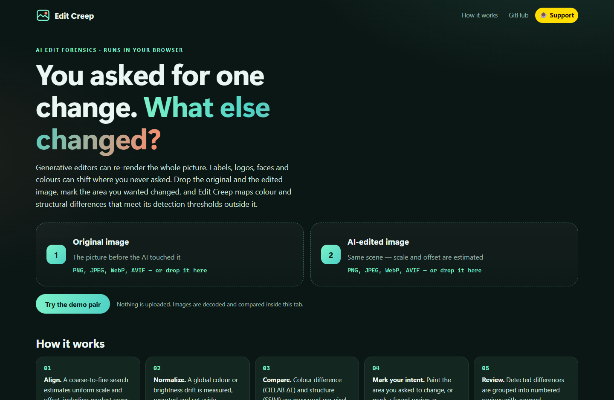
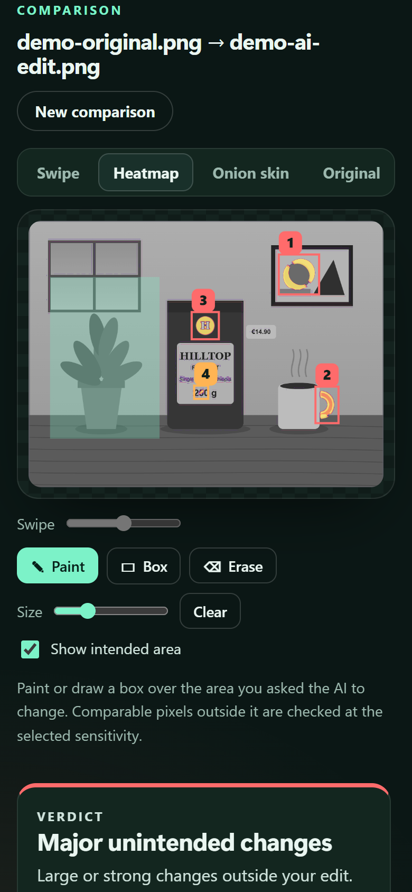

<p align="center">
  
</p>

<h3 align="center">Review what changed outside the part you asked an AI to edit.</h3>

<p align="center">
  <a href="#quick-start"><b>Quick start</b></a> ·
  <a href="#what-it-catches">What it catches</a> ·
  <a href="#how-it-works">How it works</a> ·
  <a href="#reading-the-results">Reading the results</a> ·
  <a href="#faq">FAQ</a> ·
  <a href="https://buymeacoffee.com/ufodia">Support ☕</a>
</p>

<p align="center">
  
  
  
  <a href="https://github.com/ufodia/edit-creep/actions/workflows/ci.yml"></a>
  
</p>

---

## The problem

An AI image edit can change more than you requested. A result may look right at a glance while small differences elsewhere slip through:

- a pack weight that silently became **200 g** instead of 250 g,
- a logo that drifted from brand red to orange,
- a mug that lost its handle, a hand that gained a finger,
- a price, a date or a street sign with one character changed,
- a warm colour cast over the whole frame, or a few pixels cropped from the edge.

In e-commerce, advertising, journalism and design reviews, those are not cosmetic. They are wrong product listings, rejected brand assets and corrections.

## The answer

**Edit Creep** compares an original with an edited image *inside your browser*. Mark the area you **intended** to change, then review measurable differences **outside** it through numbered regions, before/after crops and exportable evidence.

It uses transparent image-processing heuristics. It does not recognize words, certify product accuracy, or detect every meaningful change. A clean result means no remaining region met the selected thresholds. If too little unmarked, comparable area remains, the app asks for a usable comparison area instead.

<p align="center">
  
  <br><sub>The synthetic demo: the request was “replace the plant with a lamp”. Edit Creep found four changes nobody asked for.</sub>
</p>

## Who it is for

| You… | Edit Creep helps you… |
| --- | --- |
| **sell products online** | review label, colour and shape differences after an AI background swap |
| **work in a brand or design team** | catch logo, typography and colour drift before an asset ships |
| **edit photos for news or documentation** | archive a visual comparison and the settings used to create it |
| **build or evaluate image-editing models** | measure "edit locality" on real pairs, without writing a script |
| **review client work** | send a comparison sheet with numbered changes instead of a vague "something looks off" |

## Quick start

> **Requirements:** Node.js 24 and npm. No account, API key, model download or GPU.

```bash
git clone https://github.com/ufodia/edit-creep.git
cd edit-creep
npm ci
npm run dev
```

Open the printed `http://127.0.0.1:5173` address, then:

1. Drop the **original** image into slot 1 and the **AI-edited** image into slot 2 — or choose **Try the demo pair**.
2. Paint or draw a box over the area you **asked** the AI to change.
3. Review the numbered regions that remain. Click **This was intended** on any you are happy with.
4. Export a **comparison sheet**, a **heatmap** or a **JSON report**.

Common browser-decodable images include PNG, JPEG, WebP, AVIF, BMP and the first frame of GIF. Availability depends on your browser; the file limit is 80 MiB per image. The app attempts scale-and-offset alignment when the dimensions differ. A file under the limit can still exceed your device's decoding capacity.

## What it catches

<p align="center">
  
</p>

Detected regions receive heuristic labels from colour and structural signals:

| Region type | Signal | Typical cause |
| --- | --- | --- |
| **Colour changed** | colour difference (CIELAB ΔE) without structural change | logo or product recoloured, skin tone shifted |
| **Detail or text changed** | structure (SSIM) changed while average colour stayed similar | text re-rendered, texture regenerated, fine print softened |
| **Content changed** | both colour and structure changed | object added, removed, moved or redrawn |

Global effects are reported separately to help interpret local findings:

- **Colour drift** — a per-channel fit measures warm or cool casts and brightness changes across the whole picture. It is set aside before the local comparison (you can turn that off) and always shown in the results.
- **Alignment** — size, crop and offset differences are measured and reported, and any part of the original that is missing from the edit is shown as **cropped**.

## How it works

<p align="center">
  
</p>

1. **Align.** A coarse-to-fine search estimates uniform scale and offset from gradient images, then refines the match. Gradients reduce sensitivity to brightness and colour shifts; difficult scenes can still align poorly.
2. **Match resolution.** When the edit is smaller, the original is passed through the same down-and-up resampling first, so detail lost to resizing is not reported as an edit. Larger edits are area-averaged down before warping.
3. **Normalize.** A robust per-channel linear fit excludes the worst 20 % of sampled residuals to reduce the influence of local edits. It estimates global colour drift and optionally compensates for it.
4. **Compare.** Two complementary per-pixel signals: CIELAB ΔE with an anti-aliasing tolerance (a pixel is unchanged if its colour lies within the edited 3 × 3 neighbourhood), and structural dissimilarity (SSIM) that accepts one-pixel shifts.
5. **Subtract intent and group.** The area you marked, plus a small feather band, is excluded. Remaining changes are joined by morphological closing, labelled as connected components, filtered for resampling artefacts, and merged when they touch — a moved object becomes one region, not two crescents.

Alignment and comparison run in a Web Worker in your tab; decoding and rendering use browser APIs. Processing time depends on the image pair and device. Read the full [method notes](docs/method.md).

## A tour of the app

<table>
  <tr>
    <td width="60%"></td>
    <td width="40%"></td>
  </tr>
  <tr>
    <td><b>Heatmap.</b> The original in grey with change intensity on top: purple is barely above the threshold, yellow is strong. The mint area is what you marked as intended.</td>
    <td><b>Results.</b> A verdict, the alignment and colour-drift facts, sensitivity controls, and a card for every region with zoomed before/after crops.</td>
  </tr>
  <tr>
    <td></td>
    <td align="center"></td>
  </tr>
  <tr>
    <td><b>Start.</b> Two slots, one demo button. Nothing is uploaded.</td>
    <td><b>Phone-ready.</b> The full workflow fits a 390 px screen.</td>
  </tr>
</table>

Five view modes help you see changes the way that suits them: **Swipe** for before/after, **Heatmap** for intensity, **Onion skin** for subtle shifts, and the plain **Original** and **Edited** (aligned) frames.

## Reading the results

| Verdict | Meaning |
| --- | --- |
| **No changes detected** | nothing outside your marked area exceeds the threshold at this sensitivity |
| **Minor** | small, faint regions — worth a look before publishing |
| **Notable** | at least one clear change, or more than 1 % of the untouched area changed |
| **Major** | a large or strong change (or more than 5 % of the untouched area) — compare carefully before use |

If you mark the entire usable area, **No unmarked area to compare** replaces the ordinary verdict. An uncertain alignment calls for manual review; it must not be treated as a clean comparison. Transparent pixels are composited on white for comparison and display.

Each region shows its **severity**, its **share of the image**, and its **peak** — the strongest pixel in threshold units (2× means twice the change needed to count). **Sensitivity** sets those thresholds:

| Sensitivity | ΔE threshold | SSIM threshold | Smallest region |
| --- | ---: | ---: | ---: |
| Low | 12 | 0.20 | 0.04 % of the image |
| Balanced (default) | 8 | 0.13 | 0.012 % |
| High | 5 | 0.08 | 0.005 % |

These are detector settings, not perceptual guarantees. Image scaling, compression, texture and the intended-area feather can affect which differences remain.

## Exports

| File | Contents |
| --- | --- |
| `edit-creep-comparison.png` | original and aligned edit side by side, with the same numbered boxes on both and a verdict footer — ideal for a client or a ticket |
| `edit-creep-heatmap.png` | the heatmap with numbered boxes and a verdict footer |
| `edit-creep-report.json` | verdict, alignment, colour drift, noise level, settings, and every region with its box in analysis pixels **and** in the original image's own pixels |

<details>
<summary><b>Example: an excerpt of the JSON report</b></summary>

```json
{
  "tool": { "name": "Edit Creep", "version": "1.0.0" },
  "files": {
    "original": { "name": "demo-original.png", "width": 1024, "height": 768 },
    "edited": { "name": "demo-ai-edit.png", "width": 960, "height": 720 }
  },
  "verdict": "major",
  "summary": { "regions": 4, "changedShareOfUntouchedArea": 0.01219, "intendedShareOfImage": 0.18725 },
  "alignment": { "scale": 0.94298, "offsetX": -3.51, "offsetY": -2.66, "overlap": 0.9912, "doubtful": false },
  "colourDrift": {
    "significant": true,
    "deltaE": 6.23,
    "gain": [0.9682, 0.9854, 0.9266],
    "offset": [0.0324, 0.011, 0.0017],
    "compensated": true
  },
  "regions": [
    { "id": 3, "kind": "color", "severity": "major", "peak": 3.72, "boxInOriginal": { "x": 483, "y": 275, "width": 54, "height": 54 } },
    { "id": 4, "kind": "content", "severity": "moderate", "peak": 6.23, "boxInOriginal": { "x": 490, "y": 487, "width": 16, "height": 14 } }
  ]
}
```

The demo's hidden colour cast was `R × 0.97 + 8`, `G × 0.99 + 2`, `B × 0.93`. The fitted gains and offsets recover it, and region 4 is the “5” that became a “0”.

</details>

## Privacy

- **Local image processing.** Images are decoded with browser APIs and compared in a Web Worker. There is no image-upload endpoint. The Vercel configuration includes `connect-src 'none'` to restrict scripted connections.
- **No application persistence.** The app does not write image data to cookies, `localStorage`, `sessionStorage` or IndexedDB. Downloaded files remain wherever you save them.
- **No runtime packages or analytics.** Application assets are served by the host; opening the site still makes ordinary asset requests and may produce hosting access logs.

See the [privacy notes](docs/privacy.md).

## Honest limitations

Edit Creep measures pixels; it does not understand meaning. A change that is visually tiny but semantically important (a decimal point in a small price) can fall below the smallest-region size at low sensitivity, and a large but harmless change (re-rendered film grain) can be reported. Alignment models uniform scale, crop and offset, not rotation, stretching or perspective. Extremely different working dimensions or aspect ratios are rejected before alignment; use comparable views of the same scene. Treat a clean verdict as "nothing measurable changed at this sensitivity", and read the [limitations](docs/method.md#limitations).

## FAQ

<details>
<summary><b>Does it detect whether an image was made by AI?</b></summary>

No. Edit Creep needs both the original and the edited version and tells you **where they differ**. It is a review tool for edits you commissioned, not a deepfake detector.
</details>

<details>
<summary><b>The edited image is a different size. Is that a problem?</b></summary>

Moderate size, crop and offset differences are estimated automatically and reported under **Alignment**. Excessive dimension or aspect-ratio differences are rejected with a readable error. Other difficult pairs may produce an uncertain-alignment warning. Use comparable views of the same scene and inspect the match manually.
</details>

<details>
<summary><b>Why is everything highlighted when I turn off “Ignore global colour drift”?</b></summary>

Because the editor shifted the colour of the whole picture. With compensation on, that drift is measured and reported once, and the local comparison looks for changes beyond it.
</details>

<details>
<summary><b>What resolution is analysed?</b></summary>

The original's longer side is scaled to 1024 pixels for analysis; exported boxes are converted back to the original's pixels in the JSON report.
</details>

<details>
<summary><b>Can I use it on confidential images?</b></summary>

The app processes images locally and has no upload endpoint. For sensitive work, inspect the source, use a trusted browser and run your own copy. Extensions, installed security software, a compromised device, hosting changes and files you download are outside that boundary. See [privacy](docs/privacy.md).
</details>

## Documentation

| Guide | What's inside |
| --- | --- |
| [User guide](docs/user-guide.md) | every control, view mode, export and troubleshooting tip |
| [Method](docs/method.md) | alignment, resolution matching, tone fitting, metrics, grouping, thresholds and limitations |
| [Architecture](docs/architecture.md) | modules, worker protocol and report format |
| [Privacy](docs/privacy.md) | what the app can and cannot do with your images |
| [Deployment](docs/deployment.md) | building, security headers and self-hosting |
| [Changelog](CHANGELOG.md) | release notes |

## Development

```bash
npm run dev            # local development server
npm run check          # strict typecheck, unit tests and a production build
npm run test:browser   # Playwright workflows in Chromium
npm run format:check   # Prettier
npm run screenshots    # regenerate README screenshots from the synthetic demo
```

The TypeScript pipeline is tested with procedurally rendered scenes: resized and shifted edits, colour casts, recoloured logos, rewritten text, re-encoding noise and moved objects. Browser tests cover the interactive workflow and exports. CI results describe the tested revision; they are not a guarantee for every image or browser. See [CONTRIBUTING.md](CONTRIBUTING.md).

## Support

Edit Creep is free and has no ads. If it caught a wrong label before it went live, a coffee keeps it maintained.

<p align="center">
  <a href="https://buymeacoffee.com/ufodia"></a>
</p>

## License

[MIT](LICENSE) © 2026 [ufodia](https://github.com/ufodia). Created and maintained by **ufodia**, the project's sole current contributor. Third-party development tools retain their own licenses; see [THIRD_PARTY_NOTICES.md](THIRD_PARTY_NOTICES.md).
